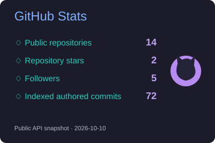
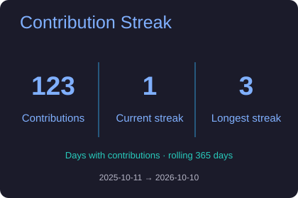
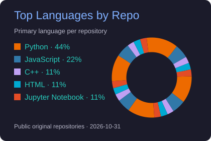
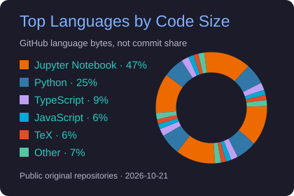
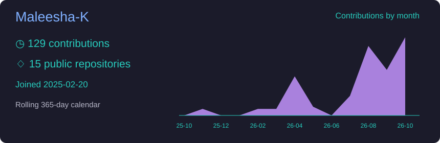
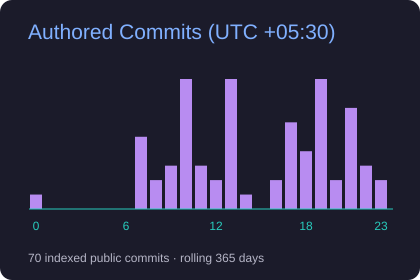
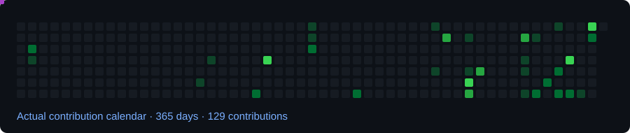

<h3 align="center">Time-Series Forecasting · Natural Language Processing · Computer Vision</h3>

    
  
  

I'm **Maleesha Piumal Kumarasinghe**, a Computer Science undergraduate at the **University of Moratuwa, Sri Lanka**. My interests span data science, machine learning, and deep learning, especially forecasting, NLP, and computer vision. I enjoy taking projects from data preparation and model evaluation through to practical integration and deployment.

## 👋 About Me

<table>
<tr>
<td width="55%" valign="top">
<code>name</code> : <strong>Maleesha Piumal Kumarasinghe</strong> 
<code>role</code> : Computer Science undergraduate 
<code>university</code> : University of Moratuwa, Sri Lanka  
<code>focus</code> 
• Data Science &amp; Machine Learning 
• Deep Learning 
• Time-Series Forecasting 
• NLP &amp; Computer Vision  
<code>approach</code> 
• Understand the data and its assumptions 
• Evaluate models carefully 
• Connect models to practical systems
</td>
<td width="45%" align="center" valign="middle">

</td>
</tr>
</table>

## 📊 Research Domains

<table>
<tr>
<td width="50%" valign="top">
<h3>📈 Time-Series Forecasting</h3>
<ul>
<li><strong>Demand forecasting</strong> — daily tourist arrivals and search-intent signals</li>
<li><strong>Structural breaks</strong> — understanding shifts in demand</li>
<li><strong>Model evaluation</strong> — rolling tests across statistical and ML models</li>
</ul>
<code>Pandas</code> <code>Scikit-learn</code> <code>SVR</code> <code>LSTM</code>
</td>
<td width="50%" valign="top">
<h3>💬 Natural Language Processing</h3>
<ul>
<li><strong>Language identification</strong> — Sinhala, Pali and Sanskrit in a shared script</li>
<li><strong>Feature engineering</strong> — vocabulary, morphology and spelling patterns</li>
<li><strong>Training &amp; evaluation</strong> — fine-tuning and zero-shot testing</li>
</ul>
<code>FastText</code> <code>Hugging Face</code> <code>Python</code>
</td>
</tr>
<tr>
<td width="50%" valign="top">
<h3>👁️ Computer Vision</h3>
<ul>
<li><strong>Occupancy sensing</strong> — real-time multi-camera processing</li>
<li><strong>YOLO integration</strong> — connecting detection to a working backend</li>
<li><strong>Edge systems</strong> — cameras, devices and live dashboards</li>
</ul>
<code>YOLO</code> <code>OpenCV</code> <code>PyTorch</code>
</td>
<td width="50%" valign="top">
<h3>🚀 Model Deployment &amp; MLOps</h3>
<ul>
<li><strong>Model serving</strong> — FastAPI prediction services</li>
<li><strong>Reproducible deployment</strong> — Docker and AWS EC2/S3</li>
<li><strong>Data pipelines</strong> — integration with MLflow and Airflow</li>
</ul>
<code>FastAPI</code> <code>Docker</code> <code>MLflow</code> <code>Airflow</code>
</td>
</tr>
</table>

## 💻 Selected Projects

| Project | Domain | Stack |
| :--- | :--- | :--- |
| **📈 [Tourism Demand Forecasting](https://github.com/rathishTharusha/srilanka-tourist-arrivals-prediction)** Collaborative research using search-intent data. **Seven architectures**, **550-day rolling test**, **8.94% rolling MAPE** with RBF-kernel SVR. **My contribution:** Data integration, feature selection and model evaluation, with a main focus on **structural-break analysis**. | Time Series · ML | `Python` `Pandas` `Scikit-learn` `SVR` `LSTM` |
| **💬 [Sinhala-Script Language Identification](https://github.com/Maleesha-K/Sinhala-Script-Language-Identification-LangID-for-Sinhala-Pali-and-Sanskrit)** Ongoing identification of **Sinhala, Pali and Sanskrit** written in the same script. **My contribution:** Feature engineering, model training, fine-tuning and evaluation including zero-shot testing. | NLP · ML | `FastText` `Hugging Face` `Python` |
| **👁️ EcoEye — Real-Time Occupancy Detection** Multi-camera occupancy sensing with edge devices and a live dashboard. **My contribution:** YOLO integration, a FastAPI/OpenCV backend, API and dashboard integration, and Docker deployment. | Computer Vision · Edge | `YOLO` `OpenCV` `FastAPI` `Docker` |

## 🛠️ Tech Stack

<h4 align="center">Languages &amp; Data</h4>

  
  
  
  
   
  
  
  
  

<h4 align="center">Machine Learning / Deep Learning</h4>

  
  
  
   
  
  
  

<h4 align="center">Model Serving · Cloud · Deployment</h4>

  
  
   
  
  
  
   
  
  

<h4 align="center">Tools &amp; Interfaces</h4>

  
  
  
  
  

## 📊 GitHub Statistics

  
  

  
  

   
  

Genuine public GitHub data · snapshot dates and coverage appear on the cards · daily refresh workflow included.

## 🐍 Contribution Snake

  <picture>
    <source media="(prefers-color-scheme: dark)" srcset="assets/activity/snake-dark.svg">
    <source media="(prefers-color-scheme: light)" srcset="assets/activity/snake.svg">
    
  </picture>

## 🏆 Achievements &amp; Leadership

- **Global Rank 51 — IEEEXtreme 2025**
- **EcoEye:** Semi-finalist, SLiOT Challenge 2026; Top 50, Spark Innovation Competition 2026
- **Board Member & Webmaster — Gavel Society, University of Moratuwa**
- **AIESEC CS Society:** Member & Sales Panelist, June 2023–June 2025

## 💭 My Approach

<h3 align="center">🌐 Let's Connect</h3>

<em>Interested in data science, machine learning, deep learning, and building practical systems.</em>

  
  

 

